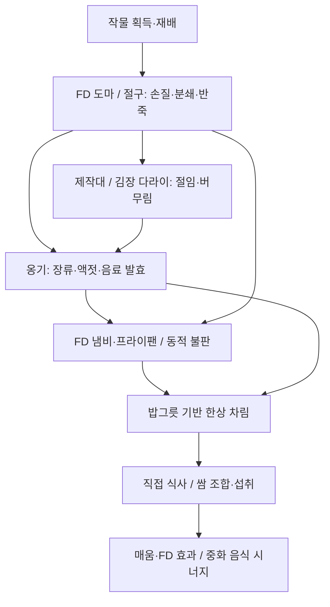

# KoreanDelight 최종 통합 기획서

작성일: 2026-11-02 · 대상: Minecraft 1.21.1 / Java 21 / NeoForge

이 문서는 기존 로드맵·제육 쌈밥 한상 구현 문서·추가 기획서를 합친 개발 기준이다. 원본 문서 3개는 이 문서로 통합했다. 충돌하는 **최종 목표는 추가 기획을 우선**하고, 기존 문서의 제작 경로·음식 목록·조작 방식은 새 목표와 양립하는 범위에서 유지한다. 아직 수치나 방식이 선택되지 않은 부분은 14절에 분리했다.

현재 구현에 관한 설명은 기존 문서가 보고한 상태이며 이번 문서 작성에서 게임 실행으로 재검증한 결과는 아니다. 아래의 목표 명세가 모두 구현되었다는 의미도 아니다. 개발 방식은 [개발 규칙](development-rules.md)과 루트 `AGENTS.md`를 따른다.

## 1. 방향과 범위

Farmer's Delight(FD)의 월드 내 조리 경험에 한식의 빻기, 절이기, 버무리기, 발효, 직화, 한상 차림을 연결한다. 완성 음식을 만드는 과정과 함께 식탁에서 여러 플레이어가 재료를 골라 쌈을 싸 먹는 과정 자체를 핵심 재미로 삼는다.

- 첫 완성 목표는 **제육볶음·공기밥·마늘·쌈장·상추·김치로 구성한 제육 쌈밥 한상**이다.
- 초기에는 도마와 제작대의 간단한 경로로 진입하고, 절구·다라이를 갖추면 높은 수율과 전용 레시피를 이용한다.
- 전용 식탁 없이 일반 블록 윗면에 음식을 놓는다. 한 블록 칸에는 식기 하나를 배치한다.
- FD 도마·냄비·프라이팬과 기존 식재료를 활용하고, 한식 고유 공정에 전용 블록을 도입한다.
- Fabric은 후속 지원 대상이며 이번 활성 개발 범위는 NeoForge다.

### 환경과 의존성

| 항목 | 기준 |
| --- | --- |
| Minecraft / Java | 1.21.1 / 21 |
| 로더 | NeoForge. 실제 버전은 `gradle.properties` 기준 |
| FD 현재 설정 | `farmers_delight_version=1.21.1-1.2.10`, 모드 메타데이터 최소 버전 `1.2.10` |
| FD 추가 기획 목표 | `1.21.1-1.3.4+`. 현재 설정과 차이가 있으므로 실제 배포본 및 API 호환성을 확인한 뒤 별도 업그레이드 |
| JEI | 제작·도마·냄비·발효·전용 가공 경로와 용기, 수율, 환경 보너스를 안내 |

이 문서는 의존성 버전을 변경하지 않는다. 목표 버전의 배포 여부 및 호환성은 이번 통합 작업에서 확인하지 않았다.

## 2. 플레이 흐름

모든 음식을 모든 공정에 통과시키지는 않는다. 나물·겉절이는 빠르게 만들고, 장류와 숙성 김치는 시간과 환경 관리로 완성한다.

## 3. 기존 기획과 추가 기획의 통합 결정

| 쟁점 | 기존 문서의 기준 | 최종 목표 및 전환 방향 |
| --- | --- | --- |
| 개발 우선순위 | 재료 → 가공 → 발효 → 완제 → 효과 | 기존 한상을 기준으로 식기·쌈을 확장하고, 절구·발효 환경·효과를 거쳐 멀티블록 완성 |
| 메주 | 콩 4개를 2×2 조합해 메주 제작 | 삶은 콩 → 절구 → 메주 덩어리 경로를 정식 공정으로 전환. 기존 직접 제작법은 전환 시 정리 |
| 고춧가루 | 생고추를 도마로 가공 | 말린 고추를 도마/절구로 가공. 건조 공정은 별도 확정 필요 |
| 떡 | FD 밥 → 떡 구상 | 찐 쌀·찹쌀 → 절구 → 떡 반죽을 정식 경로로 사용. FD 밥 재사용 가능 여부는 레시피 확정 시 결정 |
| 김치 | 배추와 양념을 옹기에 직접 투입 | 다라이에서 절임·버무림 후 옹기에서 숙성. 겉절이는 제작대 호환 |
| 장류·액젓 | 물·기존 재료 중심 발효 | 소금물·메줏가루·찹쌀풀·소금 및 어패류를 사용하는 전통 공정으로 확장 |
| 식기 | 밥그릇·나무 그릇·두 칸 그릇 혼용, 제육은 용기 없음 | 밥그릇을 공통 투입·회수 용기로 통일하고 음식별 모델로 분화 |
| 마늘·쌈장 | 두 칸 그릇의 한 재료 | 두 칸 그릇 제거. 마늘 그릇·쌈장 그릇을 각각 제작·배치하고 독립적으로 덜어 사용 |
| 다 먹은 음식 | 제육은 사라짐, 상추는 나무 그릇 반환 | 모든 식기는 빈 모델로 남고 회수 시 빈 밥그릇 1개 반환 |
| 배치 음식 우클릭 | 상추 이외는 사용 전 전체 회수 | 빈손 우클릭은 1회분 식사/상추 꺼내기. 전체 회수는 빈손 Shift + 우클릭으로 통일 |
| 쌈 보상 | 재료 합산 + 허기·포만감 각각 0.5 | 재료 합산 + 3종 이상 포만감 20% + 조합별 효과 연장. 기존 고정 0.5 보너스는 대체 |
| 쌈 표시 | 안내 한 줄 | 속재료 목록 표시, 최대 5종 |
| 매움 | 신속·한기 저항 구상 | 이동·채굴·공격 속도 증가, 과열, 중화로 재설계 |
| 식혜 | 정화 또는 재생 구상, 냄비/발효 경로 | 중화 음식 역할을 우선 확정. 기존 조리 경로는 유지 대상으로 두고 별도 정화·재생 부여는 미확정 |

기존 아이템 ID·저장 데이터는 실제 구현 전환 시 호환성 검토 대상이다. 이 표는 기획상 전환 방향이며 기존 월드의 아이템을 즉시 삭제하거나 자동 변환한다는 뜻은 아니다.

## 4. 농사와 기초 재료

### 4.1 첫 한상 진입 경로

작물은 기존 마늘·대파·콩·고추·배추 5종에 추가 작물 상추·들깨를 더한 총 7종으로 정한다. 들깨는 파종과 가공에 쓰는 주산물이며 깻잎은 부산물이다. 참깨·볶은 참깨·참기름은 기획 범위에서 제외하고, 식용유는 들깨로 만드는 들기름을 사용한다. 비빔밥 등 들기름과 참기름을 모두 사용할 수 있는 요리는 들기름으로 통일한다.

- 가위 없이 잔디 또는 키 큰 잔디를 파괴하면 12% 확률로 상추 씨앗·들깨 씨앗·배추 씨앗·고추 씨앗·대파 씨앗·마늘·콩 중 하나를 동일 확률로 얻는다. 추가 드롭 총확률은 유지하고 7종 중 하나를 선택한다.
- 상추는 경작지에서 8단계로 성장하며 골분을 사용할 수 있다. 성숙 시 상추와 씨앗, 미성숙 시 씨앗을 회수한다. 상추 1개 → 씨앗 1개 조합을 유지한다.
- 들깨도 경작지에서 8단계로 성장하며 골분을 사용할 수 있다. 성숙 시 깻잎과 들깨 씨앗, 미성숙 시 씨앗을 회수한다. 깻잎 1개 → 들깨 씨앗 1개 조합을 제공한다. 깻잎은 그대로 먹거나 상추와 동일한 조작으로 쌈을 만들 수 있으며, 펼친 쌈으로 바뀌어도 잎의 영양치를 보존한다.
- 들깨의 성장 4단계 모델과 씨앗·깻잎 아이콘은 기존 바닐라 리소스를 재사용한 임시 에셋이다. 기존 `CropBlock`의 성장·골분·판정 처리를 사용하며 별도 블록 엔티티나 매 틱 처리는 추가하지 않는다.
- 복제 개발 월드에서 골분 성장·소모, 성숙 깻잎·씨앗 수확, 미성숙 씨앗만 회수, 깻잎→씨앗 제작, 실제 잔디의 들깨 씨앗 드롭에 대한 8개 검사가 통과했다.
- 마늘과 콩은 수확물 자체를 파종에 쓰고, 씨앗이 분리된 작물은 전용 씨앗을 쓴다.
- 메주는 바닥에 놓거나 천장에 매달아 숙성한다. 숙성 후에도 배치 형태를 유지하며 지지 블록 제거 시 떨어지고, 숙성 메주를 회수할 수 있어야 한다.

### 4.2 재료 범위

| 분류 | 재료 |
| --- | --- |
| 기존 한상 기반 | 상추, 들깨(깻잎), 배추, 고추, 대파, 마늘, 콩, FD 쌀·양파·양배추, 육류·생선 |
| 양념·발효 | 다진 마늘 `minced_garlic`, 고춧가루, 간장, 된장, 고추장 `gochujang`, 액젓 `fish_sauce` 1종, 쌈장 |
| 중간 가공품 | 다진 생선살 `minced_fish`, 생 어묵 반죽 `raw_fish_cake`, 어묵 `fish_cake`, 떡 `tteok` |
| 추가 공정용 | 소금·소금물, 말린 고추, 삶은 콩, 메주 덩어리·메줏가루, 찐 쌀·찹쌀, 찹쌀풀·쌀가루·떡 반죽, 들기름 |
| 확장 식재료 | 무, 나물, 새우·멸치, 두부 등 각 레시피에 필요한 재료 |

추가 재료의 신규 작물화 여부, 외부 모드 태그 재사용, 세부 ID 및 획득법은 확정할 항목이다. 칼국수 면은 기존 계획대로 FD 생파스타 면을 재사용한다.

상추와 들깨의 작물·씨앗·수확물은 구현 범위에 포함한다. 들기름은 추가할 가공품으로 정하며, 들깻가루와 전용 들깨 요리의 추가 여부는 후속 검토한다. 기존 코드에 남아 있는 참깨·볶은 참깨·참기름 등록은 기획 제외에 맞춰 구현 작업 시 정리한다.

2026-11-02 아이템 기반 작업에서 절굿공이·소금·말린 고추·삶은 콩·메주 덩어리·메줏가루·찹쌀·찐 쌀·찐 찹쌀·찹쌀풀·쌀가루·떡 반죽·참깨·볶은 참깨·참기름·절인 배추·생새우·멸치·새우젓·두부·무·깻잎·겉절이·구운 김치·구운 마늘·숭늉·동치미·계란찜 28종을 등록했다. 크리에이티브 탭·한영 이름·임시 모델을 제공하며 영양치는 임시값이다. 이후 옹기 발효 공정과 들깨 재배·깻잎 쌈을 연결했다. 숭늉·동치미·계란찜은 빈 밥그릇 반환만 설정돼 있고 중화 효과는 미구현이다. 절구 등 나머지 설비·후속 가공은 각 시스템의 구현 상태를 따른다. 전용 아트는 후속 작업이다.

## 5. 코어 시스템 1 — 절구

단일 블록 크기 `1×1×1`의 가공 설비다. 투입 재료를 월드에 표시하고 빈손 또는 절굿공이로 빻는다.

1. 재료를 들고 우클릭해 묶음 투입한다. 최대 투입량은 원안의 8~16개 범위에서 조정한다.
2. 빈손 우클릭은 기본 진행도, 절굿공이는 2배 진행도를 부여하며 타격음과 파티클을 낸다.
3. 목표 타격 횟수에 도달하면 결과물로 바뀌고 우클릭으로 회수한다. 결과 회수 전 재타격으로 추가 생산되지 않아야 한다.

| 입력 | FD 도마 | 절구 |
| --- | --- | --- |
| 통마늘 2개 | 다진 마늘 2개 | 다진 마늘 3개 |
| 말린 고추 2개 | 고춧가루 2개 | 고춧가루 3개 |
| 삶은 콩 | 가공 불가 | 메주 덩어리 |
| 찐 찹쌀·쌀 | 가공 불가 | 떡 반죽·쌀가루 등 해당 레시피 결과 |
| 들깨 (병 처리·전처리·수율 확정 필요) | 가공 불가 | 들기름 |

절구에서는 통마늘 2개 → 다진 마늘 3개, 말린 고추 2개 → 고춧가루 3개의 2:3 수율을 적용한다. FD 도마는 기존 1:1 수율을 유지하며, 위 표는 같은 투입량 2개를 기준으로 비교한다.

주재료 단일 슬롯을 기본으로 한다. 들기름처럼 병이 필요한 레시피는 용기 처리 규칙이 추가로 필요하며, 단일 슬롯에 두 재료가 동시에 들어간다고 가정하지 않는다. 용기 투입·회수 방식은 구현 전에 확정한다.

## 6. 코어 시스템 2 — 김장 다라이

`2×2×1` 수평 멀티블록으로 대량 절임·버무림을 담당한다. 마스터 한 곳이 재료와 진행 상태를 보관하고 나머지 부분의 조작은 마스터에 위임한다.

| 상태 | 동작과 전환 |
| --- | --- |
| `EMPTY` | 배추·무·나물 등 주재료 투입 |
| `BRINING` | 소금·물 양동이를 넣으면 절이기 시작 |
| `BRINED` | 절임 시간이 끝나 양념 투입 가능 |
| `SEASONING` | 고춧가루·다진 마늘·액젓 등 양념 최대 4종 투입 |
| `MIXING` | 내부에서 점프하거나 우클릭을 반복해 버무림 |
| 완료 | 결과물을 회수하고 다음 배치를 시작 |

- **제작대 호환:** 겉절이·기본 나물 무침은 제작대에서도 만들 수 있다. 다라이에서는 동일 주재료 기준 양념 소모를 줄이고 결과량을 1.5~2배로 늘린다.
- **전용 공정:** 통배추 절임과 포기김치·보쌈김치·총각김치 등 복합 김장 레시피는 다라이를 사용한다.
- 원안의 ‘5종 이상 재료’는 주재료와 양념을 합친 수다. ‘양념 최대 4종’과 구분한다.
- 부품 파괴나 공간 부족 시 재료·완료 결과의 중복 지급 및 소실을 막는 회수 규칙이 필요하다. 물 양동이는 빈 양동이를 반환한다.

## 7. 코어 시스템 3 — 옹기 발효

기존 옹기의 시간 기반 발효를 확장한다. 선호 환경과 무관한 배치에서도 기본 속도로 진행되며 조건을 만족하면 1.5배로 가속한다.

| 선호 환경 | 조건 | 주 대상 |
| --- | --- | --- |
| `SUNNY` | 하늘이 보이고 낮임 | 간장·된장·고추장 |
| `COOL` | 옹기 위치의 밝기 ≤ 7 | 김치·묵은지·액젓 |
| `ANY` | 환경 가속 없음 | 환경 선호가 없는 레시피 |

`COOL`은 원안의 밝기 판정을 사용한다. 실제 바이옴 온도나 냉장 기능을 의미하지 않는다. 여러 조건을 동시에 만족해도 배율은 중첩하지 않는다. 기존 레시피에 환경 필드가 없으면 `ANY`로 처리하는 호환 방향을 사용한다.

옹기 1차 변경에서 위 환경 가속을 구현했다. 간장·된장과 고추장은 `sunny`, 김치·묵은지·액젓은 `cool`을 사용하고 식혜는 기본 `any`를 유지한다. 레시피 JSON의 선택 필드 `environment`로 지정하며, GUI 진행 막대 툴팁에 선호 환경·현재 환경 배율·예상 남은 시간을, JEI에 선호 환경과 가속 조건을 표시한다. 뚜껑이 열려 있으면 진행하지 않고, 낮·밤이나 밝기가 바뀌어도 이미 쌓인 진행도는 유지한다. 반 틱 진행도는 저장하며 기존 정수 진행도 저장도 읽을 수 있다.

옹기 본체의 2차 변경에서 아래 발효 공정을 연결했다. 소금물은 별도 유체를 만들지 않고 옹기에 넣은 물과 소금으로 처리한다. 겉절이는 기존 기획의 제작대 호환 경로를 사용하고, 다라이 전용 통배추 절임·고급 김장은 해당 설비의 구현 범위로 남긴다.

| 계열 | 최종 공정 | 기존 경로와의 관계 |
| --- | --- | --- |
| 간장·된장 | 숙성 메주 + 소금물 → 간장 유체 + 된장 | 기존 물 1000mB → 간장 1000mB 경로와 된장 블록 1개 → 된장 4개를 수율 기준으로 참고 |
| 고추장 | 고춧가루 + 메줏가루 + 찹쌀풀 → 발효 | 기존 된장/메주·쌀/설탕 중심 경로를 정식 공정으로 전환 |
| 김치 | 절임·버무림 → 생김치/겉절이 → 익은 김치 → 묵은지 | 다라이와 옹기의 역할 분리 |
| 액젓 | 어패류 + 소금 → 액젓 1종 | 기존 액젓 아이템·유체를 재사용. 기존 물 1000mB + 다진 생선살 4개 발효법은 공정 전환 대상 |
| 식혜 | 물 + FD 밥 + 설탕 + 밀 → 식혜 | 기존 발효 경로 유지 대상. 냄비 조리 경로도 음식 목록에 유지 |

발효 시간, 소금물 양, 김치 숙성 단계별 수율, 액젓 병입 수량은 레시피 데이터 확정 시 결정한다. 간장과 된장은 동일 발효에서 함께 나오며 한쪽만 중복 회수할 수 없어야 한다.

### 현재 구현된 옹기 경로

| 결과 | 1배치 투입 | 결과 수율 / 기본 시간 |
| --- | --- | --- |
| 간장·된장 | 숙성 메주 1개 + 소금 1개 + 물 1000mB | 간장 1000mB + 된장 블록 1개(된장 4개) / 2400틱 |
| 고추장 | 고춧가루 1개 + 메줏가루 1개 + 찹쌀풀 1개 | 고추장 1개 / 1600틱 |
| 김치 | 겉절이 1개, 빈 유체 탱크 | 김치 1개 / 1200틱 |
| 묵은지 | 김치 1개, 빈 유체 탱크 | 묵은지 1개 / 기존 100틱 유지 |
| 액젓 | 다진 생선살·생새우·멸치 중 합계 4개 + 소금 1개, 빈 유체 탱크 | 액젓 1000mB / 1200틱 |
| 식혜 | FD 밥 1개 + 설탕 1개 + 밀 1개 + 물 1000mB | 식혜 1개 / 1200틱 |

위 수치는 구현 기준값이며 밸런스 조정 대상이다. 기존 대량 발효 시간 계산과 250mB 병입을 유지한다. 뚜껑을 닫아 둔 김치는 이어서 묵은지가 되므로 일반 김치 상태로 회수하려면 다음 숙성이 끝나기 전에 뚜껑을 연다.

절구·찹쌀 작물이 완성되기 전에도 옹기 공정을 이용할 수 있도록 소금은 물 양동이 1개 → 4개, 메줏가루는 숙성 메주 1개 → 4개, 찹쌀풀은 FD 밥 1개 + 물 양동이 1개 → 1개의 제작대 보완 경로를 제공한다. 겉절이는 배추·고춧가루·다진 마늘·액젓 병을 각각 1개씩 조합한다. 물 양동이와 액젓 병의 빈 용기를 반환한다. 찹쌀풀의 일반 쌀밥 대체 경로는 찹쌀 전용 공정 도입 시 재검토한다.

발효 결과의 아이템·유체·재료 용기 반환은 공간을 확인한 후 한 번에 반영한다. 출력 공간이나 유체 용량이 부족하면 재료를 소모하지 않는다. 기존 월드의 재료·유체는 보존하지만 변경된 레시피에 맞게 소금을 추가하거나 기존 재료를 회수해 다시 준비해야 한다.

### 옹기 최적화 기준과 검증

- 레시피 일치 여부·실패 사유·배치 결과는 재료·유체가 바뀌거나 데이터팩 레시피가 교체될 때만 다시 계산한다. GUI의 상태 조회도 같은 캐시를 사용한다.
- `ANY`는 환경을 조회하지 않고, 양지/암실은 필요한 환경 정보만 최대 20틱마다 확인한다. 환경 변화 반영에는 최대 약 1초가 걸린다.
- 용기 입력은 슬롯이나 유체가 바뀐 경우에만 재시도한다. 발효 중에는 저장용 청크 상태만 표시하며 진행도만으로 인벤토리 전체 패킷이나 비교기 이웃 갱신을 반복하지 않는다.
- 발효 완료 시 슬롯별 중간 상태를 전송하지 않고 최종 상태를 한 번 동기화한다. 인벤토리 변경 알림은 캐시를 무효화하고 데이터팩 재로딩도 감지한다.
- 자동 검사에서 정상 배치와 불일치 배치를 각각 20,000번 조회해 추가 레시피 판정 및 결과 컨테이너 재생성이 없음을 확인한다. 재료·유체 변경, 레시피 교체, 용기 반환, 공간 부족, 김치 단계 전환도 검사한다.
- 2026-11-02 원본 월드를 보존한 복제 개발 월드에서 발효 6종, 양지·암실 가속, 보완 제작법 4종, 빈 용기 반환 4건의 총 16개 자동 검사가 통과했다. 별도 멀티플레이 접속과 대규모 TPS 실측은 아직 수행하지 않았다.

현재 조리·발효용 젓갈류는 기존 액젓(`fish_sauce`) 한 종류로 통일한다. 새우젓 등 별도 젓갈의 상차림은 후속 고려사항으로 분리하며, 필수 제작·발효 공정에 포함하지 않는다. 앞선 아이템 기반 작업에서 등록한 새우젓(`salted_shrimp`)은 후속 검토 대상으로 두고 이번 문서 수정에서 코드를 삭제하지 않는다.

## 8. 코어 시스템 4 — FD 가열 조리와 동적 불판

### 8.1 FD 조리 역할

FD 냄비는 국·탕·찌개·국밥·볶음 요리에, 프라이팬 및 화로·훈연기·모닥불은 부침개와 어묵 굽기에 활용한다. 냄비 재료는 최대 6종과 별도 용기로 구성한다. 음식에 포함된 병·그릇 반환과 결과를 담는 용기 소모는 구분한다.

### 8.2 동적 불판

- `1×1`, `2×2`, `3×3` 등 꽉 찬 `N×N` 정사각형을 이루면 모서리·변·중앙 모델과 텍스처가 연결된다. 비정형 연결은 각 블록의 `1×1` 외형을 사용한다.
- 각 블록은 독립 3슬롯이다. `1×1`은 3점, `2×2`는 12점, `3×3`은 27점을 동시에 굽는다.
- 클릭한 로컬 위치로 슬롯을 선택해 재료를 올리고, 익은 고기는 빈손으로 집어 먹거나 쌈으로 집어 속재료에 넣는다.
- 조리는 **생고기 → 최적 익힘 → 탄 고기/숯** 순서다. 방치하면 타므로 회수 시점이 중요하다.
- 육류를 한 번 이상 구운 불판은 `GREASY`가 된다. 여기에 김치·마늘을 올려 구운 김치·구운 마늘을 만들고 추가 포만감을 얻는다.
- 정사각형으로 연결된 `2×2` 이상 불판은 하단 일부의 유효 열원으로 전체에 열을 전달한다. 열원 후보는 모닥불·화로·FD 스토브다.
- 연결이 바뀌어도 슬롯 내용물과 조리 진행은 해당 블록에 남는다. 열원이 사라졌을 때의 진행·식음 규칙, 최대 연결 크기와 기름 상태 범위는 확정 대상이다.

## 9. 코어 시스템 5 — 한상 차림과 쌈

### 9.1 공통 용기와 배치

`rice_bowl`을 공통 용기로 삼는다. 제작대에서 음식을 담거나 지원하는 FD 냄비 요리를 받으면 음식 종류에 맞는 배치형 아이템이 된다. 모든 FD 음식을 자동 변환하는 것으로 가정하지 않고 지원 음식을 레시피로 정의한다.

| 내용물 | 배치 형태 | 사용 |
| --- | --- | --- |
| 쌀밥·잡곡밥 | 공기밥 | 직접 식사, 쌈에 밥 추가 |
| 국·찌개·탕 | 검은 뚝배기 | 3~4회분 식사, 음식이 남아 있을 때 끓는 소리·김 |
| 쌈장·마늘·고추 | 개별 종지 | 쌈에 선택한 양념 추가 |
| 상추·깻잎 | 쌈채소 판 | 잎을 한 장씩 꺼내 쌈 시작 |
| 김치·수육·불고기·제육 | 반찬 접시/음식별 받침 모델 | 직접 식사, 쌈에 반찬 추가 |

상추 접시와 별도로 나무 접시에 담긴 깻잎 `perilla_leaf_bowl`을 제공한다. 깻잎 5장과 바닐라 나무 그릇 1개로 제작하며 사용 전에는 깻잎 5장과 나무 그릇으로 분리할 수 있다. 월드에 배치한 뒤 빈 주 손 또는 재료를 담지 않은 깻잎을 든 주 손으로 우클릭하면 한 장씩 꺼내고, 마지막 장을 꺼내면 나무 그릇을 반환한다. 상추와 깻잎은 서로 섞어 꺼낼 수 없다. 전체 회수와 일부 사용 후 회수 제한은 상추 접시와 동일하다. 기존 식기 블록 엔티티·렌더러·분량 처리를 재사용하고, 깻잎 접시 모델은 상추 접시 모델에 색상만 구분한 임시 리소스를 사용한다.

빈 밥그릇은 철 조각 3개를 그릇 모양으로 조합해 1개 제작하고 철 조각 획득 시 해금한다. 기존 공기밥 경로를 유지한다.

- 빈 밥그릇 + FD 밥 → 공기밥. 기존 FD 밥의 나무 그릇은 반환한다.
- 미사용 공기밥 + 나무 그릇 → FD 밥 + 빈 밥그릇으로 옮겨 담을 수 있다.
- FD 냄비의 용기 칸이나 냄비 우클릭으로 공기밥을 받는다. 재료·시간·경험치는 로드된 FD 밥 레시피를 따른다.
- 공기밥 아이템의 기존 기준은 허기 6·포화도 계수 0.4·Comfort 30초다.
- 손에 든 음식은 일반 우클릭 유지로 먹고, Shift + 블록 윗면 우클릭으로 배치한다.
- 클릭한 X/Z 위치를 저장하고 모델과 판정이 함께 이동한다. 음식별 크기에 따라 블록 밖으로 나가지 않게 보정한다.

### 9.2 식기 생명주기

공통 식기 동작은 `AbstractHansangDishBlock`을 설계 기준으로 하되, 실제 클래스 구조는 기존 구현을 검토해 결정한다.

1. **음식 있음:** 빈손 우클릭은 1회분을 먹고, 쌈을 든 우클릭은 재료 1회분을 담는다. 상추 접시는 먹는 대신 잎 한 장을 준다. 성공 시에만 `SERVINGS`가 감소한다.
2. **미사용 전체 회수:** 빈손 Shift + 우클릭으로 음식 전체를 회수한다. 부분 사용 음식은 기존처럼 음식째 회수·역조합할 수 없게 해 횟수 초기화를 막는다.
3. **마지막 1회분 사용:** 내용물만 사라지고 배치 위치에 빈 식기 모델이 남는다. 뚝배기의 소리·파티클은 즉시 멈춘다.
4. **빈 식기 회수:** 빈손 우클릭으로 제거하고 빈 밥그릇 1개를 반환한다.
5. **리필:** 빈 식기에 동일한 음식을 넣으면 그 음식을 소모하고 최대 회분으로 채운다. 음식별 리필 투입량은 레시피로 정의하며 무료 충전은 허용하지 않는다.

첫 한상의 제육·공기밥·김치·양념은 기존 5회분을 출발점으로 사용한다. 상추는 5장을 담아 한 장씩 꺼낸다. 뚝배기는 3~4회분 범위에서 음식별로 결정한다. 파괴 시에는 미사용 음식은 음식 아이템, 부분 사용·빈 식기는 빈 용기만 드롭하는 기존 회수 원칙을 따른다.

마늘·쌈장은 각각 빈 밥그릇 1개와 해당 재료 1개로 개별 그릇을 만든다. 각각 5회분을 덜 수 있고, 마지막 사용 후 빈 밥그릇이 배치 위치에 남는다. 음식 아이템을 그대로 먹으면 빈 밥그릇을 반환하며 미사용 그릇은 제작대로 내용물과 용기를 분리할 수 있다. 두 칸 그릇과 합본 마늘·쌈장 그릇은 등록·제작법·리소스에서 제거한다. 기존 쌈의 합본 재료 기록은 개별 마늘·쌈장 두 재료로 해석한다. 기존 월드의 제거된 그릇 아이템·블록은 자동 변환하지 않는다.

나무 그릇을 쓰는 상추와 용기 없이 나오는 제육은 공통 용기 목표로 전환해야 한다. 제작·냄비 용기·섭취 반환·파괴 드롭·역조합을 함께 맞춘다.

### 9.3 쌈 조합과 섭취

1. 쌈채소 판에서 한 장을 꺼낸다. 생상추를 직접 들고 시작하는 기존 경로도 유지한다.
2. 잎 또는 펼친 쌈으로 익은 고기·공기밥·양념 종지·반찬을 우클릭해 담는다. 순서는 자유이고 필수 속재료는 없다.
3. 속재료는 **최대 5종**, 같은 재료는 한 번만 담는다. 중복·용량 초과·유효하지 않은 재료 입력은 식탁과 손의 아이템을 소모하지 않는다.
4. 한 종 이상 넣고 Shift + 우클릭하면 접힌 쌈이 된다. 허공과 블록을 향한 접기를 모두 지원한다. 재료 없는 상태의 접기는 소모 없이 실패한다.
5. 완성 쌈은 일반 우클릭 유지로 먹으며 반환 용기가 없다.

펼친 쌈은 중첩되지 않는다. 상추 묶음으로 시작해도 한 장만 사용하고 나머지는 인벤토리로 돌려주며, 공간이 없으면 떨어뜨린다. `SsamContentsComponent`와 같은 1.21.1 DataComponent에 재료를 저장·동기화하고 툴팁에 속재료 목록을 표시한다. 속재료 5종 제한에서 바깥 잎은 제외한다.

영양 계산은 잎과 실제 담은 재료의 허기 및 **실제 포만감 회복량**을 합산한다. 포화도 계수를 단순 합산하지 않는다. 서로 다른 속재료 3종 이상이면 합산 포만감에 20% 보너스를 적용한다. 고기+마늘+쌈장 조합은 효과 시간 연장 대상으로 두고 연장 수치를 별도로 확정한다. 기존 허기·포만감 각각 +0.5 규칙은 함께 중첩하지 않는다.

현재 구현은 쌈을 접을 때 최종 영양·재료의 음식 효과를 `FOOD` 컴포넌트에 저장하고 섭취 시작 시 재합산하지 않는다. 섭취 취소·재시도는 영양을 증가시키지 않으며, 기존 허기 0.5 누적 지급도 제거했다. 김치 등 재료에 설정된 매움 효과의 지속시간·강도·확률을 그대로 전달하고, 별도 조합 시간 연장은 수치 확정 전까지 적용하지 않는다. 펼친 쌈과 완성 쌈 모두 속재료 목록·종류 수를 표시하며, 3종 이상이면 포만감 20% 보너스 안내도 표시한다. 완성 쌈의 효과 안내는 FD의 음식 효과 툴팁 설정을 따른다. 변경 전에 이미 접은 쌈은 저장된 음식 수치를 유지하므로 새 영양·효과 규칙은 새로 접은 쌈부터 적용된다.

복제 개발 월드에서 상추·깻잎 각각의 2종 무보너스·3종 보너스, 펼친/완성 툴팁, 접기, 섭취 취소 10회 반복, 실제 섭취 영양 및 매움 효과에 대한 총 36개 검사가 통과했다. 임시 검증 코드는 배포 빌드에 포함하지 않는다.

기존 구현은 식탁 음식 하나를 5회 덜면서 각 쌈에 음식 영양을 더하는 구조로 문서화되어 있다. 목표에서도 1회분 영양과 음식 전체 영양의 관계를 명시해야 하며, 해당 배분 수치는 밸런스 확정 항목이다.

## 10. 코어 시스템 6 — 매움과 중화

| 항목 | 최종 목표 |
| --- | --- |
| 적용 음식 | 김치·제육·떡볶이 등 매운 음식. 완성 쌈은 포함 재료에 따라 적용 |
| 이동 속도 | 매움 레벨당 +10% |
| 채굴 속도 | 매움 레벨당 +10% |
| 공격 속도 | 매움 레벨당 +5% |
| 속성 연산 | `ADD_MULTIPLIED_TOTAL` 기준 |
| 매움 I~II | 속도 보너스, 과열 페널티 없음 |
| 매움 III 이상 | 연속 섭취로 도달, 연기 파티클과 과열 페널티 |
| 중화 음식 | 우유·식혜·숭늉·동치미·계란찜 |
| 중화 보상 | 과열 해제 + 현재 남은 매움 지속시간 30% 연장 |

과열 페널티는 원안의 두 후보인 ‘초기 3초간 약한 화염 피해(0.5칸)’ 또는 ‘배고픔 소모 증가’ 중 하나를 확정한다. 둘을 동시에 부여하지 않는다. 효과의 기본 시간·스택 갱신·최대 레벨·중화 반복 상한과 우유의 일반 효과 제거 동작 간 우선순위를 구현 전에 결정한다.

국밥·닭칼국수·비빔밥 등에는 기존 계획의 FD `Comfort` / `Nourishment` 연계를 유지한다. 매움, FD 효과, 쌈 조합 연장은 각각의 적용 대상을 정해 중복 증폭을 제어한다.

## 11. 음식 및 레시피 카탈로그

아래는 최종 포함할 음식과 기본 경로다. `/`는 레시피 대안 후보이며 어느 조합이나 자유롭게 허용한다는 뜻은 아니다. 미확정 재료·수량은 실제 데이터 작성 전에 확정한다.

| 음식 / ID | 경로 |
| --- | --- |
| 쌈장 | 된장 + 고추장 + 다진 마늘 → 제작대 |
| 생 어묵 반죽 `raw_fish_cake` | FD 생 대구/연어 조각 → 도마로 다진 생선살 → 밀가루 반죽·다진 마늘과 조합 |
| 어묵 `fish_cake` | 생 어묵 반죽 → 화로·훈연기·모닥불/FD 프라이팬 |
| 김치전 `kimchi_jeon` | 밀 + 달걀 + 김치 + 간장병 → 반죽 `raw_kimchi_jeon` → 굽기 |
| 해물파전 `pajeon` | 밀 + 달걀 + 대파 + 다진 생선살 + 간장병 → 반죽 `raw_pajeon` → 굽기 |
| 비빔밥 `bibimbap` | FD 밥 + 달걀프라이 + 채소 2~3종 + 고추장 + 간장/들기름 → 무정형 조합 |
| 닭칼국수 `chicken_kalguksu` | FD 생파스타 면 + 생닭고기 + 대파 + 다진 마늘 + 고추/간장 + 물병 → FD 냄비 + 용기 |
| 떡볶이 `tteokbokki` | 떡 + 어묵 + 대파 + 양배추 + 고추장 + 간장/설탕 → FD 냄비 + 용기 |
| 제육볶음 `jeyuk_bokkeum` | 생돼지고기 + 양파 + 대파 + 다진 마늘 + 고추장 + 간장병 → FD 냄비 |
| 돼지국밥 `pork_gukbap` | FD 냄비. 기존 기획에 재료표가 없어 상세 레시피 확정 필요 |
| 된장찌개 `doenjang_jjigae` | 된장 + 돼지고기/소고기 + 두부 + 대파 + 다진 마늘 + 물병 → FD 냄비 + 용기 |
| 식혜 `sikhye` | FD 밥 + 물병 + 설탕 + 밀 → FD 냄비 + 유리병. 옹기 발효 경로도 유지 대상 |
| 김치·묵은지 / 액젓 | 다라이·옹기 파이프라인 |
| 구운 고기·구운 김치·구운 마늘 | 동적 불판 |
| 숭늉·동치미·계란찜 | 중화 음식으로 포함. 상세 조리법은 확정 필요 |

기존 문서에 명시된 수치와 경로는 다음을 전환 출발점으로 보존한다.

- 전 반죽은 밀 사용 시 1개, `c:foods/dough/wheat` 반죽 사용 시 2개다. 굽기 시간은 화로 200틱·훈연기 100틱·모닥불 600틱, 경험치 0.35다.
- 간장병을 재료로 쓰면 빈 유리병을 반환한다.
- 제육은 현재 문서 기준 200틱, 결과 용기 없이 낮은 나무 받침 모델로 나온다. 목표에서는 공통 식기에 맞춰 결과 용기와 빈 그릇 잔류를 함께 변경한다.
- 옹기는 벽돌 7개 U자 조합, 된장 블록은 된장 4개로 분해하는 기존 제작 경로를 유지 대상으로 둔다.
- 공기밥 외 요리도 최종적으로 공통 밥그릇을 지원하며, 식혜는 유리병 음료다.

## 12. 현재 기반과 개발 순서

### 12.1 문서에 기록된 현재 기반

기존 한상 문서에는 작물 획득·상추 재배, 메주 배치·숙성·회수, 옹기와 장류 제작 경로, FD 냄비 제육, 공기밥 수령·JEI 연동, 클릭 위치 배치, 식탁 재료로 쌈 만들기, 사용 횟수 저장이 기록되어 있다. 전 반죽 제작·굽기 경로는 기존 로드맵에 구현된 것으로 기록되어 있다.

반찬·제육·작물 모델과 일부 아이콘은 임시 에셋이다. 기존 문서의 확인 기록에는 개발 월드 검증이 있으나 별도 멀티플레이 접속 검증은 없다. 따라서 저장·동기화 구현 기록을 멀티플레이 검증 완료로 보지 않는다.

### 12.2 마일스톤

| 단계 | 작업 | 완료 기준 |
| --- | --- | --- |
| M1 기반 정리·옹기·매움 | 기존 한상 회귀 확인, 용기 전환 정책·FD 버전 결정, 옹기 환경 보너스, 매움·중화 | 기존 제작 경로 보존, 환경별 1배/1.5배 진행, 효과·중화 검증 |
| M2 절구·식기 공통 동작 | 도마/절구 수율 분리, 메주·떡 공정, 공통 식기·개별 종지·빈 모델·리필 | 재료부터 절구 결과 회수 가능, 전 식기의 회수·리필·반환 일관성 |
| M3 한상·쌈 확장 | 기존 쌈 데이터 전환, 5종 제한·목록 툴팁·영양·조합 보너스, 뚝배기 | 제육 한상 전체 루프, 저장 후 재개, 소비·보상 중복 없음 |
| M4 멀티블록 | 동적 불판·열전도·기름칠, 다라이 절임·버무림·대량 수율 | 연결/해체·열원 변경·동시 조작 검증, 김장→옹기 숙성 연결 |
| M5 음식 확장·출시 정리 | 음식 카탈로그 완성, 중화 음식, JEI·번역·전용 아트·밸런스 | 생존에서 재료 획득부터 식사까지 가능, 필수 검증 통과 |

이미 있는 밥그릇·쌈 기능을 신규 등록부터 다시 만드는 대신 목표와 다른 부분을 확장한다. 멀티블록이 완성되기 전에도 첫 한상은 도마·제작대·옹기·FD 냄비로 플레이 가능하게 유지한다. 기존 대체 레시피 제거는 새 경로가 연결된 시점에 수행한다.

## 13. 구현 및 검증 기준

- 공통 콘텐츠는 `common`, NeoForge 이벤트·FD 연동·JEI 등 로더별 처리는 `neoforge`에 둔다. 등록 추상화와 초기화 순서를 유지한다.
- 옹기 레시피는 기존 `FermentationRecipe` 기반을 검토해 확장한다. 추가 기획의 `OnggiRecipe` 명칭만을 이유로 기존 타입을 교체하지 않는다.
- 일반 제작·화로 계열은 `ModRecipeProvider`와 datagen을 사용한다. 커스텀 발효·김장·FD 레시피는 기존 프로젝트 방식을 따른다.
- 1.21.1 경로는 `recipe/`, `loot_table/`, `tags/block/` 등을 사용한다. 블록 전리품의 하위 경로는 이 프로젝트의 `loot_table/blocks/` 기준을 따른다. 결과 스택은 `id`, 재료는 `item` 또는 `tag`를 사용한다.
- 배치 좌표·음식 회분·쌈 재료·가공 진행은 저장·재접속·동기화 후 유지한다. 재료 소비와 보상은 서버에서 확정한다.
- 한국어·영어 번역, 아이템·블록 모델, JEI 경로를 콘텐츠와 함께 제공한다. 임시 아트와 최종 아트를 구분한다.

| 검증 | 확인 사항 |
| --- | --- |
| `./gradlew.bat build` 및 관련 테스트 | 컴파일, 식기·재료·반환 용기·영양 계산의 핵심 로직 |
| `./gradlew.bat :neoforge:runData --stacktrace` | 제작법·발전 과제 생성 후 생성 diff 검토 |
| `./gradlew.bat :neoforge:runClient` | 생존 획득→가공→상차림→쌈→빈 그릇 회수, 모델·판정·JEI·번역 |
| 전용 서버 및 멀티플레이 | 동시 덜기·리필·불판 회수, 저장/재시작, 멀티블록 해체 시 중복·소실 여부 |

특히 부분 사용 음식의 역조합, 슬롯이 가득 찬 상태의 반환, 가공 중 블록 파괴, 원하지 않는 중복 쌈 재료, 불판 열원 변경, 중화 반복 사용을 확인한다.

## 14. 세부 확정이 필요한 항목

큰 시스템 방향은 위 명세로 통합한다. 아래 항목은 원문에서 범위·대안으로 남았거나 두 문서만으로 결정할 근거가 없어 임의의 확정 수치를 넣지 않았다.

| 항목 | 결정할 내용 | 결정 시점 |
| --- | --- | --- |
| 의존성 | FD 목표 버전의 배포·호환성, 업그레이드 범위 | M1 시작 |
| 저장 호환 | 나무 상추 접시·제육 받침의 기존 아이템/블록 전환. 두 칸 그릇은 제거하고 쌈의 합본 기록만 두 재료로 보존 | M1~M2 |
| 신규 재료 | 소금·고추 건조·들기름·찹쌀·새우·멸치·두부 등의 획득법과 ID | 해당 레시피 구현 전 |
| 절구 | 8~16개 중 투입 상한, 타격 횟수, 병 처리, 메주 성형·떡 후속 공정 | M2 |
| 다라이·옹기 | 배치량·정수 산출·양념 절약률, 시간·소금물 양·결과 수율 | M2~M4 |
| 식기·영양 | 음식별 최대 회분·리필 투입량, 1회분 영양 배분, 뚝배기 3/4회 선택 | M2~M3 |
| 쌈 | 조합별 효과 연장 수치와 적용 대상 | M3 |
| 매움 | 시간·최대 단계·스택 규칙, 과열 페널티 선택, 중화 반복 상한·우유 처리 | M1 |
| 불판 | 최대 N, 열원 활성 조건, 조리·탄화 시간, 기름칠 범위·초기화, 식음 규칙 | M4 |
| 음식 확장 | 돼지국밥·숭늉·동치미·계란찜 등의 상세 재료, 대안 레시피 확정 | M5 |

### 후속 고려사항 — 상차림용 젓갈

핵심 조리·발효·한상 시스템을 마무리한 뒤, 새우젓 등 젓갈을 종지에 담아 상 위에 올리는 콘텐츠를 검토한다. 현재 필수 구현 범위에서 제외하며, 종류·제작법·섭취 및 쌈 연동 여부는 후속 검토 시 결정한다. 기존 액젓 한 종류로 통일한 조리 재료 체계는 유지한다.

기존 구현 경로와 과거 검증 기록의 상세는 아래 부록에 보관한다. 이후 기획 변경은 이 문서를 먼저 갱신하고, 현재 구현 설명과 개발 일정도 함께 맞춘다.

## 부록. 기존 제육 쌈밥 한상 구현 기록

아래는 통합 전 구현 문서의 상세 기록이다. 목표 명세와 다른 현재 동작을 확인하기 위해 보관하며, 당시 검증 결과를 이번 정리 작업에서 재검증하지 않았다.

이 부록의 두 칸 그릇·마늘과 쌈장 합본 관련 설명은 제거 전 기록이다. 현재 동작은 9절의 개별 마늘·쌈장 그릇을 따른다.

기존 제작 경로·조작법·검증 기록 펼치기

첫 한상은 제육볶음, 공기밥, 마늘, 쌈장, 상추, 김치로 구성한다.
전용 식탁 없이 일반 블록 윗면에 차리며, 한 블록 칸에 음식 하나를 배치한다.

### 재료부터 상차림까지

1. 가위 없이 잔디 또는 키 큰 잔디를 부수면 12% 확률로 한상용 작물 재료 하나를 얻는다.
   상추 씨앗, 배추 씨앗, 고추 씨앗, 대파 씨앗, 마늘, 콩 중 하나이며 각각 같은 확률이다.
2. 상추는 경작지에 씨앗으로 심는다. 8단계로 성장하고 골분을 사용할 수 있다.
   다 자라면 상추와 씨앗을, 덜 자라면 씨앗을 회수한다. 상추 하나를 씨앗 하나로 조합할 수도 있다.
3. 콩 4개를 2×2로 조합해 메주를 만든다. 바닥에 놓거나 랜턴처럼 천장에 매달아 숙성시킨다.
   바닥에서는 걸이용 로프가 없고, 천장에서는 로프가 위 블록까지 이어진다. 숙성되어도 배치 상태는 유지한다.
   받치는 바닥이나 천장을 제거하면 메주가 떨어지며, 완전히 숙성한 메주를 회수할 수 있다.
4. 벽돌 7개를 U자로 조합해 옹기를 만든다. 기존 발효법에 따라 물과 발효된 메주로 간장과 된장 블록을 얻는다.
   된장 블록 하나는 된장 4개로 조합한다. 고추장과 김치, 액젓은 기존 옹기 발효법을 사용한다.
5. 된장 + 고추장 + 다진 마늘을 무정형 조합하면 쌈장 하나를 얻는다.
6. 빈 밥그릇 두 개를 무정형 조합해 **빈 두 칸 그릇**을 만든다. 여기에 마늘과 쌈장을 하나씩 넣으면 **마늘과 쌈장**을 얻는다.
   모델은 작은 그릇 두 개가 옆으로 붙어 있는 모양이며, 먹으면 빈 두 칸 그릇을 반환한다.
   상추는 **바닐라 나무 그릇 + 상추 5장**로 제작한다. 낮은 나무 접시 위에 상추 잎을 펼쳐 놓은 모델이며, 먹거나 마지막 상추를 꺼내면 나무 그릇을 반환한다.
   김치는 기존대로 빈 밥그릇에 담는다. 사용 전 상추 접시는 조합창에서 상추 5장과 나무 그릇으로, 김치 그릇은 김치와 빈 밥그릇으로 다시 분리할 수 있다.
7. FD 냄비에 생돼지고기, 양파, 대파, 다진 마늘, 고추장, 간장병을 각각 하나씩 넣는다.
   200틱 동안 가열하면 별도 용기 없이 제육볶음을 받는다. 간장병은 빈 유리병으로 반환된다.
   제육은 밥그릇 대신 낮은 나무 받침 위에 고기와 채소를 크게 펼친 배치 음식이다. 폭은 기존 그릇의 약 2.2배이며, 섭취 후 그릇을 반환하지 않는다.
8. 공기밥은 기존 FD 밥 → 전용 밥그릇 경로를 사용한다.

### 그릇 조작

- 일반 우클릭: 손에 든 음식을 먹는다. 마늘·쌈장은 빈 두 칸 그릇, 상추는 나무 그릇, 김치·공기밥은 빈 밥그릇을 반환한다. 제육은 반환 용기가 없다.
- Shift + 블록 윗면 우클릭: 클릭한 위치에 배치한다.
- 배치된 상추를 빈 주 손 또는 생상추를 든 주 손으로 우클릭: 한 장씩 집어 최대 5장까지 꺼낸다. 마지막 장을 꺼냈을 때 나무 그릇을 인벤토리로 반환한다.
- 사용 전 상추 접시 전체를 회수하려면 빈손으로 Shift + 우클릭한다. 다른 사용 전 그릇은 기존처럼 빈손 우클릭으로 회수한다. 한 번이라도 덜어 수량이 줄었다면 음식째 회수할 수 없으며 안내 메시지를 표시한다.
- 사용 전 음식은 파괴해도 음식 그릇으로 드롭한다. 일부 사용한 음식은 파괴하면 남은 내용물 없이 빈 용기만 드롭한다. 제육은 반환 용기가 없다. 다 사용하고 남은 빈 그릇은 회수할 수 있다.
- 위치 저장과 멀티플레이 동기화는 기존 밥그릇 구현을 공유한다.
- 배치 위치 보정은 음식별 판정 크기를 따르므로 큰 제육이나 두 칸 그릇도 한 칸 밖으로 벗어나지 않는다.

제육과 상추의 기존 아이템 ID는 유지한다. 개별 마늘 그릇과 쌈장 그릇의 등록 및 리소스는 제거했으며, 마늘·쌈장은 합쳐진 두 칸 그릇으로만 다룬다.
조합법은 JEI에서, 제육은 FD 냄비 카테고리에서 확인할 수 있다.

### 외형과 범위

반찬과 제육의 배치 모델, 상추의 4개 성장 모델은 바닐라 텍스처를 이용한 임시 voxel 모델이다.
상추 씨앗 아이콘은 임시로 밀 씨앗 텍스처를 사용한다. 전용 픽셀 아트는 후속 작업이다.
삼겹살·갈비찜, 한 칸에 여러 그릇 놓기는 포함하지 않는다.

### 검증

- `./gradlew.bat build`: 기존 상호작용 검사와 음식 속성·반환 용기 보존 검사 포함.
- `./gradlew.bat :neoforge:runData --stacktrace`: 제작법과 해금 발전 과제 생성.
- `./gradlew.bat :neoforge:runClient`: 별도 `KoreanDelight Meal QA` 월드에서 실제 리소스 로딩과 상차림 확인.

기존 작물·옹기·메주의 loot table 경로를 `loot_table/block`에서 `loot_table/blocks`로 옮겼다.
메주 성숙도 조건의 `age`도 문자열로 수정해 실제 숙성 메주 회수를 연결했다.
작물 블록 태그 경로는 1.21.1의 `tags/block/crops.json`을 사용한다.

#### 개발 월드 확인 결과

- 상추와 씨앗 수확, 숙성 메주 드롭 확인.
- 잔디 loot를 600회 생성하여 상추·배추·고추·대파 씨앗, 마늘, 콩의 실제 획득 확인.
- 초기 구현에서 6개 재료를 넣은 FD 냄비 조리와 유리병 반환을 확인했다. 제육은 개선판에서 용기를 필요로 하지 않도록 변경했다.
- 간장 재료의 유리병 반환 확인.
- 개선판의 두 칸 그릇 제작, 마늘·쌈장 담기, 나무 접시의 상추 담기·꺼내기를 실제 자동 제작기로 확인했다.
- 상추를 꺼낸 뒤 나무 그릇이 실제로 반환되는 것을 확인했다.
- 개선판의 용기 없는 제육 냄비 조리를 확인했다.
- 새 모델의 텍스처 참조 및 회전한 상추 잎을 포함한 모델이 클릭 판정 범위 안에 들어가는지 확인했다.
- 별도 멀티플레이 접속 검증은 하지 않았다.

큰 제육, 공기밥, 나무 접시의 상추, 마늘·쌈장 두 칸 그릇, 김치로 구성한다.

### 쌈 싸 먹기

1. 빈손으로 배치된 상추 접시를 우클릭하여 한 장을 집는다. 생상추를 든 채 다시 우클릭하면 한 장씩 더 집을 수 있다.
2. 손에 든 상추로 배치된 제육, 공기밥, 마늘·쌈장 두 칸 그릇, 김치 그릇을 우클릭한다. 재료 선택과 순서는 자유이며 같은 재료는 한 번만 담는다. 마늘·쌈장은 하나의 재료로 함께 담고 함께 1회분을 소모한다. 영양도 합쳐진 그릇의 값을 한 번만 더하며, 개별 마늘·쌈장 그릇은 존재하지 않는다.
3. 원하는 재료를 하나 이상 담은 뒤 Shift + 우클릭하면 쌈으로 뭉쳐진다. 허공과 블록을 향한 조작 모두 가능하다. 제육·밥·마늘/쌈장을 전부 담을 필요는 없다.
4. 완성된 쌈은 일반 우클릭을 유지해 먹는다. 상추와 실제로 담은 음식들의 허기 회복량 및 포만감 회복량을 각각 합산한 뒤 각각 0.5를 더한다. 포만감은 계수가 아닌 실제 회복량을 합산하며 반환 용기는 없다. 허기는 정수로 저장되므로 0.5 보너스를 플레이어별로 누적하여 쌈 두 개당 허기 1을 추가한다.

제육, 공기밥, 김치, 마늘·쌈장 두 칸 그릇은 각각 5회 사용할 수 있다. 공기밥도 다섯 번째 사용 후 빈 밥그릇이 남는다. 사용 전 공기밥은 바닐라 나무 그릇과 조합하여 FD 밥과 빈 밥그릇으로 되돌릴 수 있다.
마지막 재료를 담으면 제육 받침은 사라지고, 반찬은 해당 빈 그릇으로 남는다. 그릇의 배치 위치는 유지한다.
상추 접시는 상추 5장과 나무 그릇 1개로 제작하며, 한 장을 꺼내도 남은 상추는 접시에 유지된다.
남은 횟수는 월드 저장 시 블록 상태로 보존한다. 사용 전 음식만 회수·재배치할 수 있으므로 부분 사용 후 역조합으로 횟수를 초기화할 수 없다.

상추를 여러 장 들고 시작해도 한 장만 펼친 쌈으로 바뀌며, 나머지는 인벤토리에 넣는다. 공간이 없으면 바닥에 떨어뜨려 보존한다.
펼친 쌈은 중첩되지 않으며 조립 상태는 아이템 데이터로 저장·동기화된다. 툴팁은 쌈을 싸 먹을 수 있다는 안내 한 줄만 표시한다.
중복 재료와 재료 없는 상태의 접기는 원래 음식과 상추를 소모하지 않는다. 신선한 상추는 기존처럼 그냥 먹을 수도 있다.

